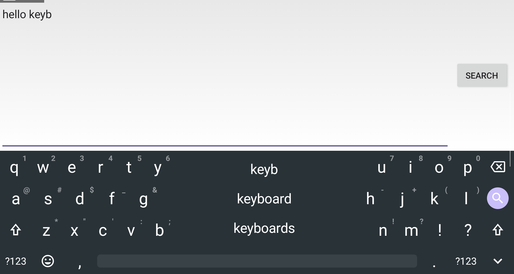

# Odin KB

A keyboard for Android gaming handhelds and other wide-screen devices, like the AYN Odin 2 Portal. It's offline, open source, and has no internet permission.

> **Odin KB is a fork of [HeliBoard](https://github.com/Helium314/HeliBoard)** by Helium314, which is itself based on OpenBoard and the AOSP keyboard. All of HeliBoard's features are still here. This fork adds changes for handhelds held with two hands in landscape. It is not affiliated with HeliBoard or AYN, so please report Odin KB problems [here](https://github.com/duhmojo/odin-kb/issues), not to HeliBoard.

*Odin KB on an Odin 2 Portal: keys at the screen edges, suggestions between your thumbs, and the space bar on the real bottom row.*

Phone keyboards on a 16:9 handheld put every key in the middle of the screen, out of reach of your thumbs. Android's gesture navigation also adds an empty row with a "hide keyboard" arrow below the keyboard, so the space bar isn't at the bottom. Odin KB splits the keyboard so the keys sit under your thumbs, lays it out more like an iPad, and gives the bottom row back to the keyboard.

## Features for handhelds

- **Split keyboard by default in landscape.** The two halves sit at the screen edges, with one wide space bar spanning the gap.
- **Suggestions between your thumbs.** Autocomplete words show in the empty middle of the split, so the strip above the keyboard is hidden and the keyboard takes less height.
- **iPad-style layout on wide screens.** Delete is at the top right, Enter is on the middle row, there's a shift key on both sides, and the bottom row is `123 · emoji · , · space · . · 123 · hide`.
- **No more empty system row.** On Android 13+ with gesture navigation, Android draws a row with a "hide keyboard" arrow under the keyboard. Odin KB removes it, so the space bar sits at the real bottom of the screen and the keyboard has its own hide key.
- **Controller typing.** Use the D-pad or left stick to move a highlight over the keys. A presses the highlighted key, B deletes, X types a space and Y toggles shift.
- **Fixes for short, wide screens.** The bottom rows (backspace, space) respond to touch on the Odin, where HeliBoard's touch area missed them.

Everything else is HeliBoard: themes, layouts, dictionaries, gesture typing (with the gesture library), clipboard history and more. See [README-HeliBoard.md](README-HeliBoard.md).

## Install

Download the latest `OdinKB-x.y.z.apk` from [Releases](https://github.com/duhmojo/odin-kb/releases), install it, then enable **Odin KB** under Settings > System > Languages & input > On-screen keyboard. Odin KB installs alongside HeliBoard and Gboard.

You can change the split width under Odin KB Settings > Appearance > Split spacer (175% by default, up to 300%).

## Build

GitHub Actions builds a debug APK on every push to `main`. Pushing a tag like `v1.2.0` builds a signed release APK and publishes it as a GitHub release. The release workflow needs the repository secrets `ODIN_KEYSTORE_BASE64`, `ODIN_KEYSTORE_PASSWORD`, `ODIN_KEY_ALIAS` and `ODIN_KEY_PASSWORD`.

To build locally you need JDK 17+, Android SDK platform 37 and NDK 28, then run `./gradlew assembleDebug`.

## License

Odin KB is a fork of HeliBoard and is licensed under the same terms: GPL-3.0, with parts under Apache-2.0 and CC-BY-SA-4.0. See [LICENSE](LICENSE), [LICENSE-Apache-2.0](LICENSE-Apache-2.0) and [LICENSE-CC-BY-SA-4.0](LICENSE-CC-BY-SA-4.0). Thanks to Helium314 and all HeliBoard and OpenBoard contributors.
